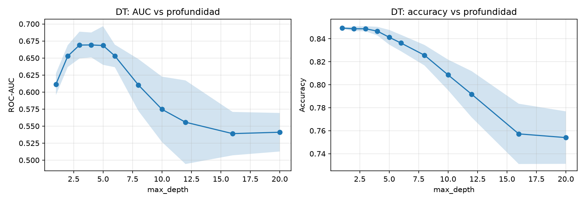
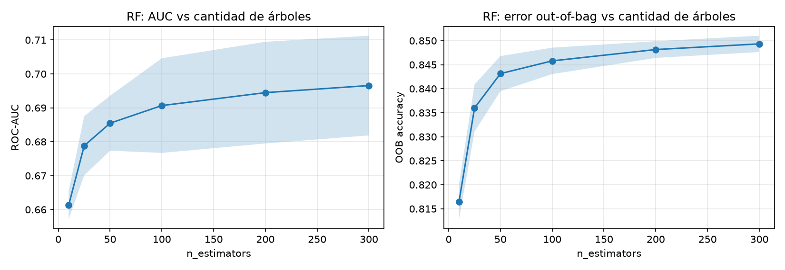
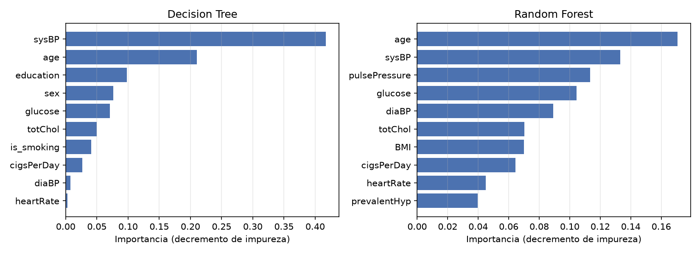

# Trabajo Práctico — Decision Tree vs Random Forest

**Inteligencia Artificial para Datos** · UTN Facultad Regional Resistencia · Ciclo lectivo 2026

**Dataset:** `data_cardiovascular_risk.csv` — *Framingham Heart Study*, predicción de
enfermedad coronaria a 10 años (`TenYearCHD`).

**Integrantes:** Ian Hakanson, Joaquin Valdez, Lucas Rabinovich

---

## Índice

1. [Introducción](#1-introducción)
2. [Informe inicial del dataset](#2-informe-inicial-del-dataset)
3. [Pre-procesamiento](#3-pre-procesamiento)
4. [Descripción de la solución implementada](#4-descripción-de-la-solución-implementada)
5. [Simulaciones y resultados](#5-simulaciones-y-resultados)
6. [Conclusiones](#6-conclusiones)
7. [Apéndice: reproducción](#7-apéndice-reproducción)

---

## 1. Introducción

El objetivo del trabajo es comparar el funcionamiento de **Decision Tree (DT)** y
**Random Forest (RF)** sobre un mismo dataset clínico, pasando por todas las
etapas de un proyecto de *machine learning*: auditoría del dato, pre-procesamiento,
implementación de los algoritmos, ajuste de hiperparámetros, evaluación y
conclusiones.

El dataset provisto por la cátedra corresponde al estudio de cohorte
*Framingham Heart Study* y plantea un problema de **clasificación binaria
desbalanceada**: predecir si un paciente desarrollará enfermedad coronaria en
los próximos diez años (`TenYearCHD = 1`) a partir de variables de riesgo
cardiovascular (edad, presión arterial, colesterol, glucemia, tabaquismo, etc.).

Los requisitos del enunciado que se cumplen son:

- pre-procesar el dataset con las técnicas vistas en clase, documentando cada decisión;
- **implementar DT y RF desde cero**, con parametrización configurable;
- exponer una **interfaz amigable** para correr pruebas y ver resultados;
- comparar el rendimiento de ambos algoritmos al variar su parametrización;
- entregar código documentado, el dataset procesado y este informe.

Toda la implementación de los algoritmos está en `dt_rf.py` y usa **sólo NumPy**.
scikit-learn se emplea para métricas y validación cruzada. Los imputadores
iterativo y KNN del pre-procesamiento también están implementados dentro del
proyecto; no se usan modelos de árboles o bosques de scikit-learn para obtener
los resultados principales.

### Entregables

| Entregable | Archivo |
|---|---|
| Notebook ejecutable en Colab | `TP_IAD_2026.ipynb` |
| Notebook con salidas | `TP_IAD_2026_ejecutado.ipynb` |
| Código fuente documentado | `dt_rf.py`, `preprocessing.py`, `experiments.py`, `plots.py`, `run_experiments.py`, `tune_final.py`, `finalize.py`, `make_figures.py` |
| Pruebas de regresión | `tests/test_core.py` |
| Dataset pre-procesado | `data/dataset_procesado.csv` |
| Informe | `informe.md` (este documento) y `informe.pdf` |
| Generador del informe | `pdf_build/build_pdf.py` |
| Tablas y figuras | `results/*.csv`, `results/resumen.json`, `results/resumen_notebook.json`, `results/protocolo.json`, `results/figuras/*.png` |

---

## 2. Informe inicial del dataset

### 2.1 Composición

| Característica | Valor |
|---|---|
| Registros | **3.390** |
| Columnas | **17** (1 identificador, 15 atributos, 1 objetivo) |
| Variable objetivo | `TenYearCHD` ∈ {0, 1} |
| Positivos | **511 (15,07 %)** |
| Negativos | 2.879 (84,93 %) |
| Ratio mayoritaria:minoritaria | **5,63 : 1** |
| Duplicados exactos | **0** (0 también al quitar `id`) |
| Celdas nulas | **510** (0,88 % del total) |
| Filas con al menos un nulo | **463** (13,66 %) |

Las variables son de tres tipos:

- **Continuas:** `age`, `cigsPerDay`, `totChol`, `sysBP`, `diaBP`, `BMI`,
  `heartRate`, `glucose`.
- **Binarias:** `sex` (M/F), `is_smoking` (YES/NO), `BPMeds`,
  `prevalentStroke`, `prevalentHyp`, `diabetes`.
- **Ordinal:** `education` (1 a 4).

`sex` e `is_smoking` vienen como texto, no como 0/1; esto obliga a codificarlas
durante el pre-procesamiento.

### 2.2 Valores faltantes

| Columna | Tipo | Nulos | % | Únicos |
|---|---|---:|---:|---:|
| `glucose` | float | 304 | 8,97 | 132 |
| `education` | float | 87 | 2,57 | 4 |
| `BPMeds` | float | 44 | 1,30 | 2 |
| `totChol` | float | 38 | 1,12 | 240 |
| `cigsPerDay` | float | 22 | 0,65 | 32 |
| `BMI` | float | 14 | 0,41 | 1.259 |
| `heartRate` | float | 1 | 0,03 | 68 |

El resto de las columnas no tiene nulos. Los faltantes se concentran en
`glucose` (8,97 %), que es además una de las variables más asociadas al riesgo
cardiovascular.

### 2.3 Outliers

Se midieron dos criterios: regla de **1,5 × IQR** y **z-score > 3**. Sólo se
analizaron las variables continuas (se excluyeron binarias, la ordinal y el `id`,
donde el concepto de outlier no aplica).

| Columna | IQR (n) | IQR (%) | z > 3 (n) | z > 3 (%) | Límite IQR inf | Límite IQR sup |
|---|---:|---:|---:|---:|---:|---:|
| `age` | 0 | 0,00 | 0 | 0,00 | 21,0 | 77,0 |
| `cigsPerDay` | 9 | 0,27 | 17 | 0,50 | −30,0 | 50,0 |
| `totChol` | 43 | 1,28 | 19 | 0,57 | 119,0 | 351,0 |
| `sysBP` | 105 | 3,10 | 39 | 1,15 | 76,5 | 184,5 |
| `diaBP` | 58 | 1,71 | 36 | 1,06 | 51,25 | 113,25 |
| `BMI` | 77 | 2,28 | 46 | 1,36 | 15,49 | 35,57 |
| `heartRate` | 64 | 1,89 | 19 | 0,56 | 45,5 | 105,5 |
| `glucose` | 158 | 5,12 | 42 | 1,36 | 47,0 | 111,0 |

`glucose`, `sysBP` y `BMI` son las que más colas presentan, lo cual es esperable
en una población clínica: los valores extremos suelen ser pacientes realmente
enfermos.

### 2.4 Inconsistencias y anomalías lógicas

| Control | Casos |
|---|---:|
| `cigsPerDay > 0` con `is_smoking = NO` | 0 |
| `cigsPerDay = 0` con `is_smoking = YES` | 0 |
| `BPMeds` nulo con `prevalentHyp = 0` | **25** |
| `BPMeds` nulo con `prevalentHyp = 1` | **19** |
| `diaBP ≥ sysBP` | 0 |

No hay valores fuera de rango fisiológico (edad 18-100, presión 60-300/30-200,
glucosa 30-600, etc.), no hay columnas constantes y no hay contradicciones entre
`cigsPerDay` e `is_smoking`. La única anomalía real es el patrón de nulos de
`BPMeds`: **25 de los 44 nulos son estructurales** (el paciente no tiene
hipertensión prevalente, por lo que la respuesta correcta es "no toma
medicación"). Los otros 19 sí son faltantes genuinos.

### 2.5 Diagnóstico

1. **Desbalance fuerte**: 15 % de positivos. Un clasificador trivial que diga
   siempre "no" acierta **84,93 %**. La accuracy por sí sola no sirve para
   comparar modelos.
2. **Faltantes no aleatorios en `BPMeds`**, que se pueden resolver con una regla
   de negocio.
3. **Colas clínicamente válidas**: eliminar outliers por IQR borraría pacientes
   de riesgo justamente en las variables que predicen riesgo.
4. **`id`** no aporta información y **`is_smoking`** es redundante con
   `cigsPerDay` (0 inconsistencias entre ambas).

---

## 3. Pre-procesamiento

### 3.1 Decisiones y fundamento

| Paso | Decisión | Fundamento |
|---|---|---|
| `id` | **eliminar** | identificador único sin poder predictivo |
| Duplicados | no hay | verificado sobre las 17 columnas y sobre todas menos `id` |
| Filas con nulos | **no eliminar** | borrar las 463 filas con algún nulo eliminaría 67 positivos (13 % de la clase minoritaria) y dejaría 2.927 registros |
| `BPMeds` nulos con `prevalentHyp = 0` | imputar **0** por regla | el nulo es estructural: no toma medicación porque no es hipertenso |
| Resto de `BPMeds` | imputar por **moda** | 19 casos, variable binaria |
| Continuas (`cigsPerDay`, `totChol`, `BMI`, `heartRate`, `glucose`) | **MICE-style iterativo propio** | preserva las correlaciones entre presión, colesterol, glucemia y BMI; imputar con la media rompería esa estructura |
| `education` | imputar por **moda** | ordinal de 4 niveles |
| Outliers | **winsorizar p1–p99** | recorta la cola sin borrar registros ni destruir la relación con la clase |
| `age`, `cigsPerDay` | **no winsorizar** | sus colas son información: los mayores y los fumadores empedernidos son la población de riesgo |
| `is_smoking` | **conservar** (se prueba quitarla) | redundante con `cigsPerDay`, pero se evalúa su impacto por ablación |
| Nuevo atributo | `pulsePressure = sysBP − diaBP` | proxy de rigidez arterial, habitual en scores de riesgo cardiovascular |
| Escalado | **no** | los árboles son invariantes a transformaciones monótonas de los atributos |

Sobre la elección de imputar en lugar de eliminar: el dataset tiene 463 filas con
algún nulo, de las cuales 67 son positivas. La eliminación *listwise* dejaría
2.927 filas (86 %) y 444 positivos, perdiendo información de la clase que
justamente se quiere predecir. La imputación múltiple es preferible.

Sobre los outliers: la regla de 1,5 × IQR marcaría 158 glucosas y 105 presiones
sistólicas (4,7 % y 3,1 %). Muchos de esos valores son clínicamente reales
(glucosa 394 mg/dl, sysBP 295 mmHg) y están asociados a la clase positiva.
Winsorizar en p1–p99 recorta sólo el 1 % más extremo de cada cola y conserva el
resto.

### 3.2 Informe final del pre-procesamiento

| Métrica | Antes | Después |
|---|---:|---:|
| Filas | 3.390 | **3.390** |
| Columnas | 17 | **17** (se quita `id`, se agrega `pulsePressure`) |
| Filas eliminadas | — | **0** |
| Celdas nulas | 510 | **0** |
| Celdas imputadas | — | **510** |
| Celdas winsorizadas | — | **375** |

**Valores imputados (510 celdas):**

| Columna | Imputados | Método |
|---|---:|---|
| `glucose` | 304 | iterativo propio |
| `education` | 87 | moda |
| `BPMeds` (regla `prevalentHyp = 0`) | 25 | regla de negocio → 0 |
| `BPMeds` (resto) | 19 | moda |
| `totChol` | 38 | iterativo propio |
| `cigsPerDay` | 22 | iterativo propio |
| `BMI` | 14 | iterativo propio |
| `heartRate` | 1 | iterativo propio |

**Outliers winsorizados (375 celdas, p1–p99):**

| Columna | Recortados | p1 | p99 |
|---|---:|---:|---:|
| `sysBP` | 68 | 95,0 | 207,0 |
| `BMI` | 68 | 17,3 | 41,5 |
| `totChol` | 67 | 133,0 | 380,0 |
| `diaBP` | 66 | 58,0 | 121,0 |
| `heartRate` | 53 | 52,0 | 118,0 |
| `glucose` | 53 | 60,0 | 245,0 |

**Outliers eliminados: 0.** Se decidió recortar (winsorizar) en lugar de
eliminar, por las razones expuestas en 3.1.

El dataset resultante (`data/dataset_procesado.csv`) tiene **3.390 filas × 17
columnas**: 15 atributos originales (sin `id`), `pulsePressure` y `TenYearCHD`.
No quedan nulos y todas las columnas son numéricas.

---

## 4. Descripción de la solución implementada

### 4.1 Arquitectura

```
dt_rf.py           Algoritmos desde cero (DecisionTree C4.5 + RandomForest)
preprocessing.py   Auditoría + pipeline de limpieza (fit/transform)
experiments.py     Métricas, validación cruzada, barridos, ablaciones
plots.py           Árbol, matrices de confusión, ROC/PR, curvas, importancias
run_experiments.py Reproduce todas las tablas del informe
tune_final.py      Grilla conjunta de hiperparámetros
finalize.py        Entrena y evalúa la configuración final
make_figures.py    Figuras del informe
TP_IAD_2026.ipynb  Notebook de Colab con la interfaz interactiva
```

La API de los modelos imita la de scikit-learn (`fit`, `predict`,
`predict_proba`, `score`, `get_params`, `set_params`) para que el notebook sea
simple y la comparación con sklearn sea directa.

### 4.2 Decision Tree (C4.5)

Implementado en la clase `DecisionTree`:

- **Criterios de impureza:** entropía y Gini.
- **Selección del split:** con entropía se usa *gain ratio* (C4.5); también se
  puede pedir *information gain* puro (`split_metric="gain"`). Con Gini se
  maximiza la reducción de impureza.
- **Atributos numéricos:** split binario `x ≤ umbral`. El umbral se busca con un
  barrido ordenado O(n log n) usando conteos acumulados por clase; si hay muchos
  valores distintos se reduce a cuantiles (`max_bins`).
- **Atributos categóricos:** split multi-vía, una rama por categoría. La
  detección es automática: dtypes no numéricos, booleanos y enteros con pocos
  niveles (`education`, `sex`, `BPMeds`, `prevalent*`, `diabetes`).
- **Parada:** `max_depth`, `min_samples_split`, `min_samples_leaf`,
  `min_impurity_decrease` y nodos puros.
- **Poda:** pesimista de C4.5 (cota binomial con `cf = 0,25`, sin datos extra) y
  *Reduced Error Pruning* (REP) con un conjunto de validación.
- **Desbalance:** `class_weight="balanced"`, que pondera cada clase por
  `n / (n_clases × n_c)`.
- **Importancia:** decremento de impureza ponderado por la fracción de muestras
  que llega a cada nodo.

### 4.3 Random Forest

Implementado en la clase `RandomForest`:

- **Bagging:** cada árbol se entrena con una muestra bootstrap (con reposición).
  El bootstrap se materializa como `sample_weight` (conteo de repeticiones), lo
  que evita duplicar filas y acelera el entrenamiento.
- **Subespacios aleatorios:** en cada split se evalúa un subconjunto aleatorio de
  atributos (`sqrt`, `log2`, fracción o entero).
- **Voto:** suave (promedio de probabilidades) o duro (mayoría).
- **OOB:** cada muestra se predice con los árboles que no la vieron; da una
  estimación del error de generalización sin costo extra.
- **Importancia:** promedio de las importancias de los árboles.
- **Paralelismo:** joblib por árbol (`n_jobs`), con fallback serial si joblib no
  está disponible.

### 4.4 Problemas encontrados y cómo se resolvieron

1. **Detección de categóricas con pandas.** `np.asarray(df)` convierte todo a
   `float` y se pierde la distinción entre `education` (ordinal de 4 niveles) y
   `age` (continua). Se agregó `_infer_categorical_from_frame`, que mira los
   dtypes del DataFrame antes de convertirlo.
2. **Dtypes extendidos de pandas.** `Int64` (nullable) rompía
   `np.issubdtype`; se resolvió inspeccionando el dtype como texto.
3. **Categorías no vistas y nulos en predicción.** Se agregó `_map_categories`,
   que enruta valores desconocidos o faltantes a una rama válida. Para datos
   crudos, los splits numéricos incorporan los faltantes en la ganancia y los
   enrutan de forma consistente; el pipeline final igualmente los imputa antes
   de entrenar.
4. **Gain ratio vs gain.** El *gain ratio* de C4.5 penaliza los splits muy
   balanceados por la entropía de la partición. En este dataset, con 15 % de
   positivos, tiende a elegir cortes que aíslan pocos casos y produce rankings
   pobres (AUC 0,59 frente a 0,65 de *gain* y 0,65 de Gini). Se dejó
   `split_metric` configurable y se reporta el hallazgo; el modelo final usa
   Gini.
5. **REP colapsa el árbol con validación chica y desbalanceada.** Con 20 % del
   train como validación, REP deja ~4 hojas y pierde AUC. La poda pesimista de
   C4.5, que no necesita datos extra, es un compromiso mejor. Ambas quedaron
   implementadas y medidas.
6. **El umbral 0,5 es poco útil con esta clase minoritaria.** El bosque casi
   nunca supera 0,5 en probabilidad suave. Se incorporó el análisis de umbral
   aprendido en train (`threshold_opt`, `f1_opt`) a todas las evaluaciones.
7. **Rendimiento.** La implementación propia es más lenta que los estimadores
   optimizados de sklearn y el preprocesamiento dentro de cada fold agrega
   costo, pero evita la fuga de información. Para árboles chicos, joblib agrega
   overhead; para bosques grandes, `n_jobs=-1` reduce el tiempo total.
8. **Etiquetado de sklearn.** `DecisionTreeClassifier` usa `criterion="gini"`
   por defecto; la primera corrida del *sanity check* comparó "entropía" contra
   gini sin avisar. Se corrigió pasando el criterio explícito.

### 4.5 Interfaz amigable

El notebook `TP_IAD_2026.ipynb` incluye dos formas de correr pruebas:

- **`run_experiment(...)`**: función que recibe los hiperparámetros de DT y RF,
  corre validación cruzada y devuelve la tabla de métricas y los modelos
  entrenados.
- **Panel con `ipywidgets`**: sliders y desplegables para profundidad, mínimo de
  muestras por hoja, criterio, cantidad de árboles, `max_features`, tipo de voto
  y cantidad de folds. Un botón ejecuta la prueba y muestra la tabla.

En Colab, la primera celda descarga los módulos y el CSV que falten desde el
commit fijado del repositorio. La subida manual sólo queda como respaldo ante
falta de red. No hace falta instalar nada.

---

## 5. Simulaciones y resultados

### 5.1 Protocolo

- **Validación cruzada estratificada 5-fold** (semilla 42) para las tablas de
  ajuste y la comparación final. En cada fold el preprocesador se ajusta sólo
  con el subconjunto de entrenamiento.
- **Hold-out 70/30 estratificado** (semilla 42) para matrices de confusión,
  curvas ROC/PR y análisis de umbral. El preprocesador también se ajusta sólo
  con el train del hold-out.
- **Métricas:** accuracy, balanced accuracy, precision, recall, F1, ROC-AUC y
  PR-AUC entendido como *average precision*. Se agrega **F1 en el umbral
  óptimo** (`f1_opt`), con el umbral aprendido en train y aplicado al fold/test,
  porque el umbral 0,5 no es razonable con 15 % de positivos.
- **Línea base trivial:** 84,93 % de accuracy prediciendo siempre 0.

### 5.2 Validación de las implementaciones contra scikit-learn

Hold-out 70/30 con preprocesamiento ajustado sólo en train. Los árboles y el
bosque propios se comparan con los estimadores de scikit-learn bajo la misma
configuración. PR-AUC corresponde a *average precision*.

| Modelo | Accuracy | Balanced acc. | Precision | Recall | F1@0,5 | F1 train-thr. | Umbral | ROC-AUC | PR-AUC/AP | Tiempo (s) |
|---|---:|---:|---:|---:|---:|---:|---:|---:|---:|---:|
| DT propio (entropía, gain ratio) | 0,8476 | 0,5284 | 0,4583 | 0,0719 | 0,1243 | 0,3211 | 0,1921 | 0,6038 | 0,2329 | 0,059 |
| DT propio (entropía, gain) | 0,8378 | 0,5199 | 0,3125 | 0,0654 | 0,1081 | 0,2055 | 0,2459 | 0,6414 | 0,2388 | 0,099 |
| DT propio (gini) | 0,8387 | 0,5394 | 0,3778 | 0,1111 | 0,1717 | 0,3419 | 0,2405 | 0,6616 | 0,2570 | 0,081 |
| DT sklearn (entropy) | 0,8358 | 0,5161 | 0,2812 | 0,0588 | 0,0973 | 0,2149 | 0,3333 | 0,6521 | 0,2353 | 0,015 |
| DT sklearn (gini) | 0,8456 | 0,5434 | 0,4474 | 0,1111 | 0,1780 | 0,3462 | 0,2500 | 0,6636 | 0,2767 | 0,007 |
| RF propio | 0,8496 | 0,5188 | 0,5000 | 0,0458 | 0,0838 | 0,3529 | 0,2388 | 0,7028 | 0,3419 | 1,441 |
| RF sklearn | 0,8515 | 0,5254 | 0,5625 | 0,0588 | 0,1065 | 0,3425 | 0,2538 | 0,7054 | 0,3309 | 0,156 |

La comparación sirve como control de implementación; los resultados principales
usan exclusivamente `DecisionTree` y `RandomForest` propios.

### 5.3 Decision Tree: efecto de la profundidad

CV 5-fold, Gini, sin poda. El umbral de F1 se aprende en el train de cada fold.

| max_depth | Accuracy | Balanced acc. | F1@0,5 | F1 train-thr. | ROC-AUC | PR-AUC/AP | Hojas |
|---|---:|---:|---:|---:|---:|---:|---:|
| 1 | 0,8493 ± 0,0007 | 0,5000 | 0,0000 | 0,3204 | 0,6115 ± 0,0159 | 0,1930 | 2,0 |
| 2 | 0,8487 ± 0,0020 | 0,5117 | 0,0530 | 0,3367 | 0,6527 ± 0,0160 | 0,2221 | 4,0 |
| 3 | 0,8487 ± 0,0022 | 0,5101 | 0,0463 | 0,3352 | 0,6690 ± 0,0197 | 0,2416 | 8,0 |
| 4 | 0,8466 ± 0,0038 | 0,5218 | 0,0963 | 0,3277 | 0,6692 ± 0,0183 | 0,2605 | 15,0 |
| 5 | 0,8413 ± 0,0064 | 0,5195 | 0,0976 | 0,3459 | 0,6683 ± 0,0284 | 0,2529 | 27,8 |
| 6 | 0,8363 ± 0,0071 | 0,5310 | 0,1432 | 0,3323 | 0,6530 ± 0,0166 | 0,2448 | 49,0 |
| 8 | 0,8257 ± 0,0089 | 0,5360 | 0,1717 | 0,2272 | 0,6104 ± 0,0381 | 0,2222 | 113,6 |
| 10 | 0,8086 ± 0,0133 | 0,5380 | 0,1902 | 0,2146 | 0,5746 ± 0,0480 | 0,2029 | 197,0 |
| 12 | 0,7917 ± 0,0201 | 0,5394 | 0,2049 | 0,2042 | 0,5557 ± 0,0614 | 0,1917 | 279,0 |
| 16 | 0,7572 ± 0,0262 | 0,5327 | 0,2082 | 0,2119 | 0,5389 ± 0,0319 | 0,1695 | 397,6 |
| 20 | 0,7540 ± 0,0228 | 0,5389 | 0,2213 | 0,2210 | 0,5410 ± 0,0283 | 0,1667 | 425,0 |

El máximo ROC-AUC aparece en depth 4 (0,6692).
La accuracy favorece árboles triviales por el desbalance; la profundidad mayor
incrementa las hojas y termina degradando el ranking.

`min_samples_leaf` con depth 8:

| min_samples_leaf | Accuracy | F1 train-thr. | ROC-AUC | Hojas |
|---|---:|---:|---:|---:|
| 1 | 0,8257 | 0,2272 | 0,6104 | 113,6 |
| 2 | 0,8248 | 0,2303 | 0,6091 | 111,6 |
| 5 | 0,8292 | 0,2728 | 0,6218 | 94,6 |
| 10 | 0,8336 | 0,2757 | 0,6336 | 79,2 |
| 20 | 0,8413 | 0,2955 | 0,6369 | 65,0 |
| 40 | 0,8457 | 0,3150 | 0,6590 | 45,4 |
| 80 | 0,8437 | 0,3194 | 0,6632 | 26,4 |

El mejor AUC del barrido de hoja es 0,6632 con
`min_samples_leaf = 80`; la profundidad sigue
siendo el hiperparámetro dominante.

### 5.4 Decision Tree: criterio de impureza y métrica de split

CV 5-fold, `max_depth = 6`.

| Impureza | Métrica de split | Accuracy | F1 train-thr. | ROC-AUC | Hojas |
|---|---:|---:|---:|---:|---:|
| Entropía | **gain ratio** (C4.5) | 0,8472 | 0,3020 | 0,5947 | 21,0 |
| Entropía | *information gain* | 0,8372 | 0,3224 | 0,6542 | 53,0 |
| **Gini** | reducción Gini | 0,8363 | 0,3323 | 0,6530 | 49,0 |

El gain ratio sigue siendo una opción C4.5 válida, pero en este dataset Gini y
information gain producen mejores rankings de riesgo. Por eso la configuración
final usa Gini y se evalúa ROC-AUC, PR-AUC/AP y no sólo accuracy.

### 5.5 Decision Tree: poda

CV 5-fold, Gini, `max_depth = 12`.

| Poda | Accuracy | F1 train-thr. | ROC-AUC | Hojas | Profundidad |
|---|---:|---:|---:|---:|---:|
| sin poda | 0,7917 | 0,2042 | 0,5557 | 279,0 | 12,0 |
| pesimista (C4.5) | 0,8142 | 0,2045 | 0,5774 | 163,8 | 12,0 |
| REP | 0,8437 | 0,3439 | 0,6523 | 20,8 | 9,4 |

La poda se ajusta usando únicamente el train de cada fold. REP dispone de una
validación interna y puede ser agresiva con pocos positivos; la poda pesimista
no necesita datos adicionales. Para el modelo final se mantiene depth 5, donde
la regularización por profundidad ya limita la varianza.

### 5.6 Decision Tree: balanceo de clases

CV 5-fold, Gini, `max_depth = 6`.

| class_weight | Accuracy | Balanced acc. | Precision | Recall | F1 |
|---|---:|---:|---:|---:|---:|
| sin balanceo | 0,8363 | 0,5310 | 0,3465 | 0,0940 | 0,1432 |
| balanced | 0,6383 | 0,6310 | 0,2375 | 0,6204 | 0,3423 |

El balanceo aumenta recall y F1 a costa de accuracy. Se conserva la opción en
la interfaz y se usa sin balanceo para la comparación principal.

### 5.7 Random Forest: cantidad de árboles

CV 5-fold, Gini, `max_depth = 12`, `max_features = sqrt`.

| Árboles | Accuracy | F1 train-thr. | ROC-AUC | OOB accuracy | Tiempo/fold (s) |
|---|---:|---:|---:|---:|---:|
| 10 | 0,8386 | 0,2714 | 0,6613 | 0,8165 | 0,33 |
| 25 | 0,8460 | 0,2994 | 0,6788 | 0,8360 | 0,69 |
| 50 | 0,8469 | 0,2941 | 0,6855 | 0,8431 | 1,31 |
| 100 | 0,8490 | 0,3024 | 0,6907 | 0,8458 | 2,55 |
| 200 | 0,8490 | 0,3227 | 0,6945 | 0,8482 | 5,15 |
| 300 | 0,8493 | 0,3195 | 0,6966 | 0,8493 | 7,88 |

El AUC y OOB se estabilizan al aumentar la cantidad de árboles, mientras que el
costo crece. Se usa la configuración de 300 árboles para el modelo final.

### 5.8 Random Forest: `max_features`, profundidad y voto

`max_features` con 100 árboles y depth 12:

| max_features | Accuracy | F1 train-thr. | ROC-AUC | OOB accuracy |
|---|---:|---:|---:|---:|
| sqrt | 0,8490 | 0,3024 | 0,6907 | 0,8458 |
| log2 | 0,8490 | 0,3024 | 0,6907 | 0,8458 |
| 0,3 | 0,8490 | 0,3024 | 0,6907 | 0,8458 |
| 0,6 | 0,8484 | 0,3159 | 0,6773 | 0,8469 |

Profundidad con 100 árboles y `max_features = sqrt`:

| max_depth | Accuracy | F1 train-thr. | ROC-AUC | OOB accuracy |
|---|---:|---:|---:|---:|
| 3,0000 | 0,8499 | 0,3562 | 0,7081 | 0,8499 |
| 5,0000 | 0,8499 | 0,3362 | 0,7149 | 0,8499 |
| 8,0000 | 0,8513 | 0,3273 | 0,7066 | 0,8491 |
| 12,0000 | 0,8490 | 0,3024 | 0,6907 | 0,8458 |
| 20,0000 | 0,8540 | 0,0831 | 0,6850 | 0,8454 |
| — | 0,8537 | 0,1070 | 0,6840 | 0,8450 |

Tipo de voto:

| Voto | Accuracy | F1 train-thr. | ROC-AUC | OOB accuracy |
|---|---:|---:|---:|---:|
| soft | 0,8490 | 0,3024 | 0,6907 | 0,8458 |
| hard | 0,8487 | 0,3112 | 0,6818 | 0,8468 |

El OOB respeta ahora el tipo de voto elegido: promedia probabilidades para voto
suave y cuenta votos para voto duro.

### 5.9 Ablaciones de pre-procesamiento

Cada configuración se evalúa con el pipeline ajustado dentro de cada fold
(5-fold, sin fuga de información). RF con 80 árboles, `max_depth = 10`, Gini.

| Configuración | Accuracy | F1 train-thr. | ROC-AUC |
|---|---:|---:|---:|
| MICE + winsor + is_smoking (base) | 0,8478 | 0,3299 | 0,6969 |
| mediana + winsor | 0,8496 | 0,3387 | 0,6989 |
| KNN + winsor | 0,8496 | 0,3100 | 0,6929 |
| MICE sin winsor | 0,8496 | 0,3330 | 0,6961 |
| MICE + sin is_smoking | 0,8513 | 0,3303 | 0,6909 |
| MICE sin pulsePressure | 0,8525 | 0,3018 | 0,6968 |

Las diferencias entre imputadores, winsorización, `is_smoking` y
`pulsePressure` deben interpretarse junto con el desvío entre folds. No se
eligen decisiones por una diferencia pequeña de un solo experimento.

### 5.10 Búsqueda conjunta y configuración final

La grilla conjunta se evalúa con preprocesamiento dentro de cada fold. La
selección se hace por ROC-AUC; por lo tanto, el valor de la grilla es un puntaje
de selección y no una estimación final independiente.

- DT: 25 combinaciones de `max_depth` y `min_samples_leaf`.
- RF: 9 combinaciones de `max_depth` y `max_features`, con 100 árboles; la
  cantidad de árboles se completa con el barrido correspondiente.

Configuraciones finales:

```python
DT: max_depth=5, min_samples_leaf=40, criterion='gini'
RF: n_estimators=300, max_depth=5, max_features='sqrt', criterion='gini'
```

### 5.11 Comparación final DT vs RF

La grilla y los barridos se usan para seleccionar la configuración. La
comparación independiente se realiza sobre el hold-out 70/30; la CV final se
reporta como referencia de selección y estabilidad.

**Validación cruzada 5-fold:**

| Modelo | Accuracy | Balanced acc. | F1@0,5 | F1 train-thr. | Umbral | ROC-AUC | PR-AUC/AP | Tiempo/fold |
|---|---:|---:|---:|---:|---:|---:|---:|---:|
| DT | 0,8454 ± 0,0038 | 0,5211 | 0,0954 | 0,3493 | 0,2341 | 0,6820 ± 0,0204 | 0,2664 | 0,053 |
| **RF** | 0,8504 ± 0,0008 | 0,5063 | 0,0267 | 0,3252 | 0,2469 | 0,7153 ± 0,0194 | 0,3294 | 1,301 |

**Hold-out 70/30:**

| Modelo | Accuracy | Balanced acc. | Precision | Recall | F1@0,5 | F1 train-thr. | Umbral | ROC-AUC | PR-AUC/AP |
|---|---:|---:|---:|---:|---:|---:|---:|---:|---:|
| DT | 0,8476 | 0,5446 | 0,4722 | 0,1111 | 0,1799 | 0,3406 | 0,2165 | 0,6728 | 0,2766 |
| **RF** | 0,8496 | 0,5027 | 0,5000 | 0,0065 | 0,0129 | 0,3662 | 0,2415 | 0,7186 | 0,3350 |

Matrices de confusión con umbral 0,5:

| Modelo | TN | FP | FN | TP |
|---|---:|---:|---:|---:|
| DT | 845 | 19 | 136 | 17 |
| RF | 863 | 1 | 152 | 1 |

Matrices de confusión con el umbral aprendido en train:

| Modelo | Umbral | TN | FP | FN | TP | Precision | Recall | F1 |
|---|---:|---:|---:|---:|---:|---:|---:|---:|
| DT | 0,216 | 598 | 266 | 67 | 86 | 0,244 | 0,562 | 0,341 |
| **RF** | 0,242 | 785 | 79 | 101 | 52 | 0,397 | 0,340 | 0,366 |

El test de Wilcoxon sobre las exactitudes por fold produce estadístico
0,000 y p = 0,1250. Como los folds de una
CV se solapan, este contraste debe considerarse descriptivo y no una prueba de
observaciones independientes.

Figuras:






### 5.12 Importancia de atributos

| Atributo | DT | RF |
|---|---:|---:|
| age | 0,2103 | 0,1706 |
| sysBP | 0,4173 | 0,1330 |
| pulsePressure | 0,0000 | 0,1133 |
| glucose | 0,0706 | 0,1045 |
| diaBP | 0,0077 | 0,0891 |
| totChol | 0,0495 | 0,0702 |
| BMI | 0,0000 | 0,0700 |
| cigsPerDay | 0,0263 | 0,0643 |
| heartRate | 0,0030 | 0,0451 |
| prevalentHyp | 0,0000 | 0,0396 |
| education | 0,0983 | 0,0304 |
| sex | 0,0764 | 0,0254 |
| diabetes | 0,0000 | 0,0203 |
| is_smoking | 0,0408 | 0,0128 |
| BPMeds | 0,0000 | 0,0087 |
| prevalentStroke | 0,0000 | 0,0028 |

Las importancias describen el modelo entrenado sobre el train del hold-out; no
son una medida causal ni sustituyen una validación clínica.




## 6. Conclusiones

1. **El desbalance domina la accuracy.** La línea base mayoritaria obtiene
   84,93 %. Por eso la comparación se centra en ROC-AUC, PR-AUC/AP,
   recall, F1 y balanced accuracy.

2. **El preprocesamiento no filtra información del test.** El dataset procesado
   completo se entrega como artefacto, pero las métricas ajustan imputadores y
   winsorización únicamente sobre cada train/fold. La transformación posterior
   reutiliza los parámetros aprendidos y no vuelve a calcularlos con el test.

3. **El umbral debe aprenderse fuera del test.** En el hold-out el umbral del RF
   se aprende en train (0,242) y luego se aplica al test, donde alcanza
   F1 = 0,3662. El umbral 0,5 sigue siendo inadecuado para esta clase
   minoritaria.

4. **RF supera a DT en el protocolo seleccionado.** En CV, el RF obtiene
   ROC-AUC 0,7153 frente a 0,6820 del DT. La
   evaluación independiente debe leerse en conjunto con el hold-out y con la
   incertidumbre entre folds, no como una garantía clínica.

5. **La implementación es propia.** Los árboles, el bosque, los imputadores
   iterativo/KNN y el cálculo OOB están implementados en el proyecto; scikit-
   learn se utiliza para métricas y particiones estratificadas, además del
   control comparativo.

6. **Limitaciones.** La selección de hiperparámetros usa la misma CV que se
   reporta como puntaje de selección; una evaluación anidada sería más estricta.
   El Wilcoxon sobre folds solapados es descriptivo. Las probabilidades y el
   rendimiento no deben interpretarse como herramienta clínica sin calibración,
   validación externa y análisis de costos de falsos negativos.

---

## 7. Apéndice: reproducción

### En Google Colab

1. Abrir el notebook directamente desde el repositorio:
   <https://colab.research.google.com/github/kahnaisehC/analisis-riesgo-cardiovascular/blob/main/TP_IAD_2026.ipynb>.
2. Hacer *Runtime → Run all*. La primera celda descarga desde GitHub los
   módulos y el CSV que falten en el entorno.
3. Si se sube solamente el `.ipynb`, la primera celda (`bootstrap`) descarga de
   GitHub —sólo si faltan— `dt_rf.py`, `preprocessing.py`, `experiments.py`,
   `plots.py` y `data_cardiovascular_risk.csv`. La subida manual queda como
   respaldo ante falta de red.
4. La sección 12 tiene el panel interactivo con sliders.

El bootstrap fija un `COMMIT` para descargar siempre la misma versión de los
archivos. La validación cruzada, el hold-out y los modelos finales fijan la
semilla; además, el preprocesamiento se ajusta dentro de cada fold o train
split para evitar fuga de información.

### Local

```bash
pip install -r requirements.txt
python preprocessing.py       # data/dataset_procesado.csv + auditorías
python run_experiments.py     # todas las tablas en results/ (~8 min)
python make_figures.py        # figuras en results/figuras/
jupyter notebook TP_IAD_2026.ipynb
```

### Estructura de `results/`

| Archivo | Contenido |
|---|---|
| `comparacion_sklearn.csv` | validación de las implementaciones propias |
| `dt_barrido_profundidad.csv` | depth × métricas |
| `dt_barrido_min_hoja.csv` | `min_samples_leaf` × métricas |
| `dt_barrido_criterio.csv` | entropía/gain ratio/gain/Gini |
| `dt_barrido_poda.csv` | sin poda / pesimista / REP |
| `dt_class_weight.csv` | efecto del balanceo |
| `rf_barrido_arboles.csv` | cantidad de árboles + OOB |
| `rf_barrido_max_features.csv` | atributos por split |
| `rf_barrido_profundidad.csv` | depth del bosque |
| `rf_voting.csv` | voto suave vs duro |
| `ablaciones_preprocesamiento.csv` | impacto de cada decisión de limpieza |
| `grilla_dt.csv`, `grilla_rf.csv` | búsqueda conjunta |
| `comparacion_final_cv.csv` | DT vs RF en CV 5-fold |
| `comparacion_final_holdout.csv` | DT vs RF en hold-out |
| `importancias.csv` | importancia por atributo |
| `resumen.json` | todas las métricas puntuales del informe |
| `resumen_notebook.json` | métricas exportadas por el notebook |
| `protocolo.json` | semilla, folds y reglas de preprocesamiento/evaluación |
