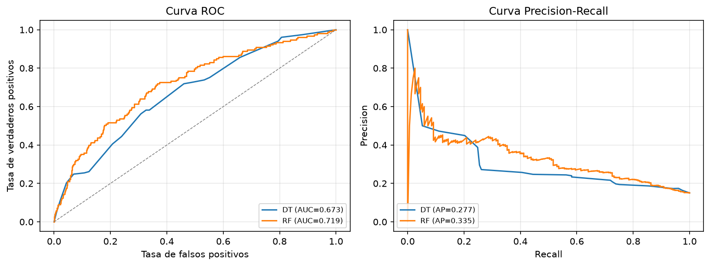
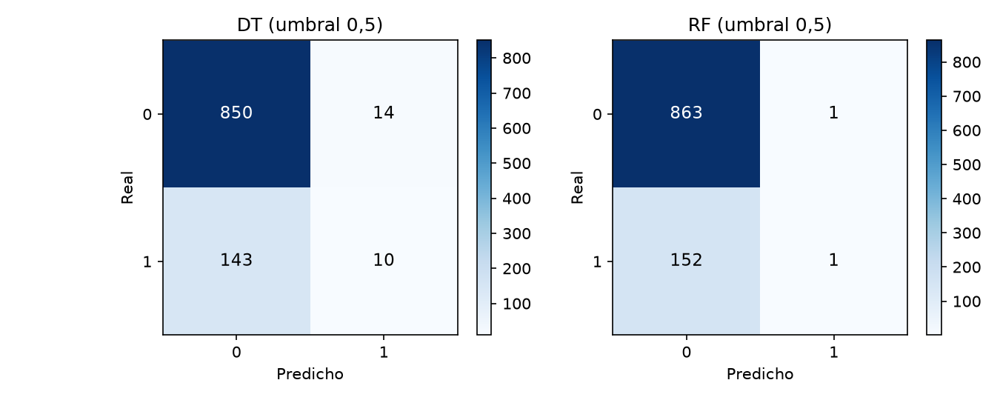
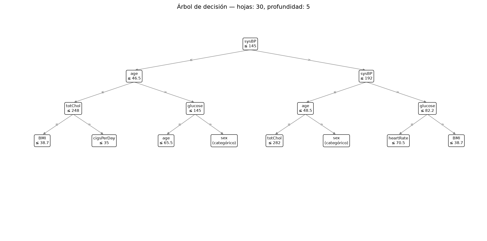

# Trabajo Práctico — Decision Tree vs Random Forest

**Inteligencia Artificial para Datos** · UTN Facultad Regional Resistencia · Ciclo lectivo 2026

**Dataset:** `data_cardiovascular_risk.csv` — *Framingham Heart Study*, predicción de
enfermedad coronaria a 10 años (`TenYearCHD`).

**Integrantes:** Ian Hakanson, Joaquin Valdez, Lucas Rabinovich

---

## Índice

1. [Introducción](#1-introducción)
2. [Informe inicial del dataset](#2-informe-inicial-del-dataset)
3. [Pre-procesamiento](#3-pre-procesamiento)
4. [Descripción de la solución implementada](#4-descripción-de-la-solución-implementada)
5. [Simulaciones y resultados](#5-simulaciones-y-resultados)
6. [Conclusiones](#6-conclusiones)
7. [Apéndice: reproducción](#7-apéndice-reproducción)

---

## 1. Introducción

El objetivo del trabajo es comparar el funcionamiento de **Decision Tree (DT)** y
**Random Forest (RF)** sobre un mismo dataset clínico, pasando por todas las
etapas de un proyecto de *machine learning*: auditoría del dato, pre-procesamiento,
implementación de los algoritmos, ajuste de hiperparámetros, evaluación y
conclusiones.

El dataset provisto por la cátedra corresponde al estudio de cohorte
*Framingham Heart Study* y plantea un problema de **clasificación binaria
desbalanceada**: predecir si un paciente desarrollará enfermedad coronaria en
los próximos diez años (`TenYearCHD = 1`) a partir de variables de riesgo
cardiovascular (edad, presión arterial, colesterol, glucemia, tabaquismo, etc.).

Los requisitos del enunciado que se cumplen son:

- pre-procesar el dataset con las técnicas vistas en clase, documentando cada decisión;
- **implementar DT y RF desde cero**, con parametrización configurable;
- exponer una **interfaz amigable** para correr pruebas y ver resultados;
- comparar el rendimiento de ambos algoritmos al variar su parametrización;
- entregar código documentado, el dataset procesado y este informe.

Toda la implementación de los algoritmos está en `dt_rf.py` y usa **sólo NumPy**.
scikit-learn se emplea exclusivamente para métricas, validación cruzada y como
control de que las implementaciones propias son correctas.

### Entregables

| Entregable | Archivo |
|---|---|
| Notebook ejecutable en Colab | `TP_IAD_2026.ipynb` |
| Notebook con salidas | `TP_IAD_2026_ejecutado.ipynb` |
| Código fuente documentado | `dt_rf.py`, `preprocessing.py`, `experiments.py`, `plots.py`, `run_experiments.py`, `tune_final.py`, `finalize.py`, `make_figures.py` |
| Dataset pre-procesado | `data/dataset_procesado.csv` |
| Informe | `informe.md` (este documento) y `informe.pdf` |
| Tablas y figuras | `results/*.csv`, `results/resumen.json`, `results/resumen_notebook.json`, `results/figuras/*.png` |

---

## 2. Informe inicial del dataset

### 2.1 Composición

| Característica | Valor |
|---|---|
| Registros | **3.390** |
| Columnas | **17** (1 identificador, 15 atributos, 1 objetivo) |
| Variable objetivo | `TenYearCHD` ∈ {0, 1} |
| Positivos | **511 (15,07 %)** |
| Negativos | 2.879 (84,93 %) |
| Ratio mayoritaria:minoritaria | **5,63 : 1** |
| Duplicados exactos | **0** (0 también al quitar `id`) |
| Celdas nulas | **510** (0,88 % del total) |
| Filas con al menos un nulo | **463** (13,66 %) |

Las variables son de tres tipos:

- **Continuas:** `age`, `cigsPerDay`, `totChol`, `sysBP`, `diaBP`, `BMI`,
  `heartRate`, `glucose`.
- **Binarias:** `sex` (M/F), `is_smoking` (YES/NO), `BPMeds`,
  `prevalentStroke`, `prevalentHyp`, `diabetes`.
- **Ordinal:** `education` (1 a 4).

`sex` e `is_smoking` vienen como texto, no como 0/1; esto obliga a codificarlas
durante el pre-procesamiento.

### 2.2 Valores faltantes

| Columna | Tipo | Nulos | % | Únicos |
|---|---|---:|---:|---:|
| `glucose` | float | 304 | 8,97 | 132 |
| `education` | float | 87 | 2,57 | 4 |
| `BPMeds` | float | 44 | 1,30 | 2 |
| `totChol` | float | 38 | 1,12 | 240 |
| `cigsPerDay` | float | 22 | 0,65 | 32 |
| `BMI` | float | 14 | 0,41 | 1.259 |
| `heartRate` | float | 1 | 0,03 | 68 |

El resto de las columnas no tiene nulos. Los faltantes se concentran en
`glucose` (8,97 %), que es además una de las variables más asociadas al riesgo
cardiovascular.

### 2.3 Outliers

Se midieron dos criterios: regla de **1,5 × IQR** y **z-score > 3**. Sólo se
analizaron las variables continuas (se excluyeron binarias, la ordinal y el `id`,
donde el concepto de outlier no aplica).

| Columna | IQR (n) | IQR (%) | z > 3 (n) | z > 3 (%) | Límite IQR inf | Límite IQR sup |
|---|---:|---:|---:|---:|---:|---:|
| `age` | 0 | 0,00 | 0 | 0,00 | 21,0 | 77,0 |
| `cigsPerDay` | 9 | 0,27 | 17 | 0,50 | −30,0 | 50,0 |
| `totChol` | 43 | 1,28 | 19 | 0,57 | 119,0 | 351,0 |
| `sysBP` | 105 | 3,10 | 39 | 1,15 | 76,5 | 184,5 |
| `diaBP` | 58 | 1,71 | 36 | 1,06 | 51,25 | 113,25 |
| `BMI` | 77 | 2,28 | 46 | 1,36 | 15,49 | 35,57 |
| `heartRate` | 64 | 1,89 | 19 | 0,56 | 45,5 | 105,5 |
| `glucose` | 158 | 5,12 | 42 | 1,36 | 47,0 | 111,0 |

`glucose`, `sysBP` y `BMI` son las que más colas presentan, lo cual es esperable
en una población clínica: los valores extremos suelen ser pacientes realmente
enfermos.

### 2.4 Inconsistencias y anomalías lógicas

| Control | Casos |
|---|---:|
| `cigsPerDay > 0` con `is_smoking = NO` | 0 |
| `cigsPerDay = 0` con `is_smoking = YES` | 0 |
| `BPMeds` nulo con `prevalentHyp = 0` | **25** |
| `BPMeds` nulo con `prevalentHyp = 1` | **19** |
| `diaBP ≥ sysBP` | 0 |

No hay valores fuera de rango fisiológico (edad 18-100, presión 60-300/30-200,
glucosa 30-600, etc.), no hay columnas constantes y no hay contradicciones entre
`cigsPerDay` e `is_smoking`. La única anomalía real es el patrón de nulos de
`BPMeds`: **25 de los 44 nulos son estructurales** (el paciente no tiene
hipertensión prevalente, por lo que la respuesta correcta es "no toma
medicación"). Los otros 19 sí son faltantes genuinos.

### 2.5 Diagnóstico

1. **Desbalance fuerte**: 15 % de positivos. Un clasificador trivial que diga
   siempre "no" acierta **84,93 %**. La accuracy por sí sola no sirve para
   comparar modelos.
2. **Faltantes no aleatorios en `BPMeds`**, que se pueden resolver con una regla
   de negocio.
3. **Colas clínicamente válidas**: eliminar outliers por IQR borraría pacientes
   de riesgo justamente en las variables que predicen riesgo.
4. **`id`** no aporta información y **`is_smoking`** es redundante con
   `cigsPerDay` (0 inconsistencias entre ambas).

---

## 3. Pre-procesamiento

### 3.1 Decisiones y fundamento

| Paso | Decisión | Fundamento |
|---|---|---|
| `id` | **eliminar** | identificador único sin poder predictivo |
| Duplicados | no hay | verificado sobre las 17 columnas y sobre todas menos `id` |
| Filas con nulos | **no eliminar** | borrar las 463 filas con algún nulo eliminaría 67 positivos (13 % de la clase minoritaria) y dejaría 2.927 registros |
| `BPMeds` nulos con `prevalentHyp = 0` | imputar **0** por regla | el nulo es estructural: no toma medicación porque no es hipertenso |
| Resto de `BPMeds` | imputar por **moda** | 19 casos, variable binaria |
| Continuas (`cigsPerDay`, `totChol`, `BMI`, `heartRate`, `glucose`) | **MICE** (`IterativeImputer`) | preserva las correlaciones entre presión, colesterol, glucemia y BMI; imputar con la media rompería esa estructura |
| `education` | imputar por **moda** | ordinal de 4 niveles |
| Outliers | **winsorizar p1–p99** | recorta la cola sin borrar registros ni destruir la relación con la clase |
| `age`, `cigsPerDay` | **no winsorizar** | sus colas son información: los mayores y los fumadores empedernidos son la población de riesgo |
| `is_smoking` | **conservar** (se prueba quitarla) | redundante con `cigsPerDay`, pero se evalúa su impacto por ablación |
| Nuevo atributo | `pulsePressure = sysBP − diaBP` | proxy de rigidez arterial, habitual en scores de riesgo cardiovascular |
| Escalado | **no** | los árboles son invariantes a transformaciones monótonas de los atributos |

Sobre la elección de imputar en lugar de eliminar: el dataset tiene 463 filas con
algún nulo, de las cuales 67 son positivas. La eliminación *listwise* dejaría
2.927 filas (86 %) y 444 positivos, perdiendo información de la clase que
justamente se quiere predecir. La imputación múltiple es preferible.

Sobre los outliers: la regla de 1,5 × IQR marcaría 158 glucosas y 105 presiones
sistólicas (4,7 % y 3,1 %). Muchos de esos valores son clínicamente reales
(glucosa 394 mg/dl, sysBP 295 mmHg) y están asociados a la clase positiva.
Winsorizar en p1–p99 recorta sólo el 1 % más extremo de cada cola y conserva el
resto.

### 3.2 Informe final del pre-procesamiento

| Métrica | Antes | Después |
|---|---:|---:|
| Filas | 3.390 | **3.390** |
| Columnas | 17 | **17** (se quita `id`, se agrega `pulsePressure`) |
| Filas eliminadas | — | **0** |
| Celdas nulas | 510 | **0** |
| Celdas imputadas | — | **510** |
| Celdas winsorizadas | — | **375** |

**Valores imputados (510 celdas):**

| Columna | Imputados | Método |
|---|---:|---|
| `glucose` | 304 | MICE |
| `education` | 87 | moda |
| `BPMeds` (regla `prevalentHyp = 0`) | 25 | regla de negocio → 0 |
| `BPMeds` (resto) | 19 | moda |
| `totChol` | 38 | MICE |
| `cigsPerDay` | 22 | MICE |
| `BMI` | 14 | MICE |
| `heartRate` | 1 | MICE |

**Outliers winsorizados (375 celdas, p1–p99):**

| Columna | Recortados | p1 | p99 |
|---|---:|---:|---:|
| `sysBP` | 68 | 95,0 | 207,0 |
| `BMI` | 68 | 17,3 | 41,5 |
| `totChol` | 67 | 133,0 | 380,0 |
| `diaBP` | 66 | 58,0 | 121,0 |
| `heartRate` | 53 | 52,0 | 118,0 |
| `glucose` | 53 | 60,0 | 245,0 |

**Outliers eliminados: 0.** Se decidió recortar (winsorizar) en lugar de
eliminar, por las razones expuestas en 3.1.

El dataset resultante (`data/dataset_procesado.csv`) tiene **3.390 filas × 17
columnas**: 15 atributos originales (sin `id`), `pulsePressure` y `TenYearCHD`.
No quedan nulos y todas las columnas son numéricas.

---

## 4. Descripción de la solución implementada

### 4.1 Arquitectura

```
dt_rf.py           Algoritmos desde cero (DecisionTree C4.5 + RandomForest)
preprocessing.py   Auditoría + pipeline de limpieza (fit/transform)
experiments.py     Métricas, validación cruzada, barridos, ablaciones
plots.py           Árbol, matrices de confusión, ROC/PR, curvas, importancias
run_experiments.py Reproduce todas las tablas del informe
tune_final.py      Grilla conjunta de hiperparámetros
finalize.py        Entrena y evalúa la configuración final
make_figures.py    Figuras del informe
TP_IAD_2026.ipynb  Notebook de Colab con la interfaz interactiva
```

La API de los modelos imita la de scikit-learn (`fit`, `predict`,
`predict_proba`, `score`, `get_params`, `set_params`) para que el notebook sea
simple y la comparación con sklearn sea directa.

### 4.2 Decision Tree (C4.5)

Implementado en la clase `DecisionTree`:

- **Criterios de impureza:** entropía y Gini.
- **Selección del split:** con entropía se usa *gain ratio* (C4.5); también se
  puede pedir *information gain* puro (`split_metric="gain"`). Con Gini se
  maximiza la reducción de impureza.
- **Atributos numéricos:** split binario `x ≤ umbral`. El umbral se busca con un
  barrido ordenado O(n log n) usando conteos acumulados por clase; si hay muchos
  valores distintos se reduce a cuantiles (`max_bins`).
- **Atributos categóricos:** split multi-vía, una rama por categoría. La
  detección es automática: dtypes no numéricos, booleanos y enteros con pocos
  niveles (`education`, `sex`, `BPMeds`, `prevalent*`, `diabetes`).
- **Parada:** `max_depth`, `min_samples_split`, `min_samples_leaf`,
  `min_impurity_decrease` y nodos puros.
- **Poda:** pesimista de C4.5 (cota binomial con `cf = 0,25`, sin datos extra) y
  *Reduced Error Pruning* (REP) con un conjunto de validación.
- **Desbalance:** `class_weight="balanced"`, que pondera cada clase por
  `n / (n_clases × n_c)`.
- **Importancia:** decremento de impureza ponderado por la fracción de muestras
  que llega a cada nodo.

### 4.3 Random Forest

Implementado en la clase `RandomForest`:

- **Bagging:** cada árbol se entrena con una muestra bootstrap (con reposición).
  El bootstrap se materializa como `sample_weight` (conteo de repeticiones), lo
  que evita duplicar filas y acelera el entrenamiento.
- **Subespacios aleatorios:** en cada split se evalúa un subconjunto aleatorio de
  atributos (`sqrt`, `log2`, fracción o entero).
- **Voto:** suave (promedio de probabilidades) o duro (mayoría).
- **OOB:** cada muestra se predice con los árboles que no la vieron; da una
  estimación del error de generalización sin costo extra.
- **Importancia:** promedio de las importancias de los árboles.
- **Paralelismo:** joblib por árbol (`n_jobs`), con fallback serial si joblib no
  está disponible.

### 4.4 Problemas encontrados y cómo se resolvieron

1. **Detección de categóricas con pandas.** `np.asarray(df)` convierte todo a
   `float` y se pierde la distinción entre `education` (ordinal de 4 niveles) y
   `age` (continua). Se agregó `_infer_categorical_from_frame`, que mira los
   dtypes del DataFrame antes de convertirlo.
2. **Dtypes extendidos de pandas.** `Int64` (nullable) rompía
   `np.issubdtype`; se resolvió inspeccionando el dtype como texto.
3. **Categorías no vistas y nulos en predicción.** Se agregó `_map_categories`,
   que enruta valores desconocidos o faltantes a la rama mayoritaria del nodo.
   Los nulos tampoco se usan para elegir el split durante el entrenamiento.
4. **Gain ratio vs gain.** El *gain ratio* de C4.5 penaliza los splits muy
   balanceados por la entropía de la partición. En este dataset, con 15 % de
   positivos, tiende a elegir cortes que aíslan pocos casos y produce rankings
   pobres (AUC 0,58 frente a 0,65 de *gain* y 0,68 de Gini). Se dejó
   `split_metric` configurable y se reporta el hallazgo; el modelo final usa
   Gini.
5. **REP colapsa el árbol con validación chica y desbalanceada.** Con 20 % del
   train como validación, REP deja ~4 hojas y pierde AUC. La poda pesimista de
   C4.5, que no necesita datos extra, es un compromiso mejor. Ambas quedaron
   implementadas y medidas.
6. **El umbral 0,5 es inútil con esta clase minoritaria.** El bosque casi nunca
   supera 0,5 en probabilidad suave: en el hold-out predice 1 positivo de 153.
   Se incorporó el análisis de umbral óptimo (`threshold_opt`, `f1_opt`) a todas
   las evaluaciones.
7. **Rendimiento.** Un árbol propio tarda ~0,07 s por fold (4–5× más que
   sklearn, que está optimizado en Cython). El bosque de 300 árboles tarda
   ~1,6 s por fold con `n_jobs=-1`. Para árboles chicos, joblib agrega overhead:
   conviene paralelizar la validación cruzada antes que los árboles.
8. **Etiquetado de sklearn.** `DecisionTreeClassifier` usa `criterion="gini"`
   por defecto; la primera corrida del *sanity check* comparó "entropía" contra
   gini sin avisar. Se corrigió pasando el criterio explícito.

### 4.5 Interfaz amigable

El notebook `TP_IAD_2026.ipynb` incluye dos formas de correr pruebas:

- **`run_experiment(...)`**: función que recibe los hiperparámetros de DT y RF,
  corre validación cruzada y devuelve la tabla de métricas y los modelos
  entrenados.
- **Panel con `ipywidgets`**: sliders y desplegables para profundidad, mínimo de
  muestras por hoja, criterio, cantidad de árboles, `max_features`, tipo de voto
  y cantidad de folds. Un botón ejecuta la prueba y muestra la tabla.

En Colab, si los módulos no están subidos, la primera celda los pide; si falta el
CSV, la celda de carga lo pide. No hace falta instalar nada.

---

## 5. Simulaciones y resultados

### 5.1 Protocolo

- **Validación cruzada estratificada 5-fold** (semilla 42) para las tablas de
  ajuste y la comparación final.
- **Hold-out 70/30 estratificado** (semilla 42) para matrices de confusión,
  curvas ROC/PR y análisis de umbral.
- **Métricas:** accuracy, balanced accuracy, precision, recall, F1, ROC-AUC y
  PR-AUC. Se agrega **F1 en el umbral óptimo** (`f1_opt`) y el umbral que lo
  logra, porque el umbral 0,5 no es razonable con 15 % de positivos.
- **Línea base trivial:** 84,93 % de accuracy prediciendo siempre 0.

### 5.2 Validación de las implementaciones contra scikit-learn

Hold-out 70/30, `max_depth = 6` para DT y `max_depth = 10`, 100 árboles para RF.

| Modelo | Accuracy | F1@0,5 | ROC-AUC | PR-AUC | Tiempo (s) |
|---|---:|---:|---:|---:|---:|
| DT propio (entropía + gain ratio) | 0,8505 | 0,1461 | 0,6081 | 0,2211 | 0,067 |
| DT propio (entropía + gain) | 0,8338 | 0,1333 | 0,6604 | 0,2508 | 0,115 |
| DT propio (Gini) | 0,8407 | 0,1735 | 0,6641 | 0,2683 | 0,092 |
| DT sklearn (entropy) | 0,8378 | 0,1361 | 0,6704 | 0,2572 | 0,008 |
| DT sklearn (gini) | 0,8437 | 0,1675 | 0,6612 | 0,2746 | 0,007 |
| **RF propio** | **0,8535** | 0,1183 | **0,7054** | **0,3414** | 2,777 |
| RF sklearn | 0,8535 | 0,0859 | 0,7034 | 0,3331 | 0,199 |

Con la misma configuración, las implementaciones propias quedan a menos de un
punto de AUC de sklearn:

- DT Gini: 0,6641 vs 0,6612 (diferencia +0,003).
- DT entropía + gain: 0,6604 vs 0,6704 (diferencia −0,010); sklearn no usa gain
  ratio, usa *information gain*, por eso la comparación justa es con
  `split_metric="gain"`.
- RF: 0,7054 vs 0,7034 (+0,002) y misma accuracy; la diferencia de F1 se explica
  por el umbral 0,5 y por el muestreo aleatorio de atributos.

La implementación de **gain ratio** (C4.5 puro) queda por debajo porque en este
dataset el criterio es inestable (ver 4.4 y 5.3). No es un error de
implementación: es el comportamiento conocido de C4.5 en problemas con clase
minoritaria chica.

Las importancias de atributos también coinciden en los primeros puestos:
`age`, `sysBP`, `glucose`, `pulsePressure` y `diaBP` aparecen en el top-5 de
ambas implementaciones.

### 5.3 Decision Tree: efecto de la profundidad

CV 5-fold, Gini, sin poda.

| max_depth | Accuracy | Balanced acc. | F1@0,5 | F1 ópt. | ROC-AUC | PR-AUC | Hojas |
|---:|---:|---:|---:|---:|---:|---:|---:|
| 1 | 0,8493 | 0,5000 | 0,0000 | 0,3095 | 0,6003 | 0,1891 | 2,0 |
| 2 | 0,8484 | 0,5035 | 0,0184 | 0,3297 | 0,6410 | 0,2159 | 4,0 |
| 3 | 0,8454 | 0,5146 | 0,0716 | 0,3389 | 0,6715 | 0,2422 | 7,8 |
| 4 | 0,8451 | 0,5322 | 0,1370 | 0,3558 | 0,6877 | 0,2671 | 15,2 |
| **5** | 0,8386 | 0,5276 | 0,1317 | **0,3637** | **0,6956** | 0,2637 | 28,4 |
| 6 | 0,8366 | 0,5360 | 0,1626 | 0,3543 | 0,6766 | 0,2513 | 48,0 |
| 8 | 0,8283 | 0,5440 | 0,1939 | 0,3544 | 0,6447 | 0,2406 | 108,2 |
| 10 | 0,8118 | 0,5592 | 0,2382 | 0,3204 | 0,6027 | 0,2207 | 190,4 |
| 12 | 0,7879 | 0,5468 | 0,2226 | 0,2937 | 0,5718 | 0,1947 | 272,0 |
| 16 | 0,7599 | 0,5480 | 0,2338 | 0,2644 | 0,5470 | 0,1726 | 389,4 |
| 20 | 0,7522 | 0,5467 | 0,2343 | 0,2620 | 0,5473 | 0,1688 | 422,6 |

El accuracy máxima se alcanza en árboles triviales (depth 1–2) porque predicen
casi todo negativo. El **AUC máximo está en depth 5** (0,6956); a partir de ahí
el árbol sobreajusta: la accuracy de test baja, el AUC cae y las hojas se
multiplican. Es el compromiso sesgo-varianza clásico.

`min_samples_leaf` (depth 8 fijo) tiene un efecto suave, con máximo en 40
(AUC 0,6575) y muy poco spread (0,628–0,658): la profundidad es el
hiperparámetro dominante.

### 5.4 Decision Tree: criterio de impureza y métrica de split

CV 5-fold, `max_depth = 6`.

| Impureza | Métrica de split | Accuracy | F1 ópt. | ROC-AUC | Hojas |
|---|---|---:|---:|---:|---:|
| Entropía | **gain ratio** (C4.5) | 0,8469 | 0,2961 | 0,5813 | 21,6 |
| Entropía | *information gain* | 0,8398 | 0,3428 | 0,6483 | 52,4 |
| **Gini** | reducción de Gini | 0,8366 | **0,3543** | **0,6766** | 48,0 |

La accuracy favorece al gain ratio (0,8469), pero su AUC es **nueve puntos
menor**. El gain ratio divide la ganancia por la entropía de la partición y
premia splits que separan pocos casos; esos cortes mejoran la exactitud
aparente pero ordenan mal las probabilidades. Gini y gain son mejores para
*ranking* (que es lo que miden ROC-AUC y PR-AUC). Este es uno de los hallazgos
más interesantes del TP: **optimizar accuracy habría llevado a elegir el peor
modelo para uso clínico**.

### 5.5 Decision Tree: poda

CV 5-fold, Gini, `max_depth = 12`.

| Poda | Accuracy | F1 ópt. | ROC-AUC | Hojas | Profundidad |
|---|---:|---:|---:|---:|---:|
| Sin poda | 0,7879 | 0,2937 | 0,5718 | 272,0 | 12,0 |
| Pesimista (C4.5) | 0,8115 | 0,3181 | 0,5982 | 161,8 | 12,0 |
| **REP (20 % validación)** | **0,8428** | **0,3534** | **0,6406** | **22,6** | 9,6 |

Ambas técnicas de poda mejoran al árbol sin poda. REP es la que más reduce el
tamaño (272 → 23 hojas) y la que mejor AUC logra, pero depende de un conjunto
de validación: con folds chicos y 15 % de positivos, la poda puede ser agresiva
y colapsar el árbol (se observó en configuraciones con `max_depth` alto y
`min_samples_leaf = 5`, donde dejó 3,6 hojas). La poda pesimista es más estable
pero conserva 162 hojas.

Para la configuración final se eligió un árbol **poco profundo y sin poda**
(depth 5): la poda no aporta cuando el árbol ya está regularizado por
profundidad.

### 5.6 Decision Tree: balanceo de clases

CV 5-fold, Gini, `max_depth = 6`.

| `class_weight` | Accuracy | Balanced acc. | Precision | Recall | F1 |
|---|---:|---:|---:|---:|---:|
| Sin balanceo | **0,8366** | 0,5360 | **0,3614** | 0,1056 | 0,1626 |
| `balanced` | 0,6339 | **0,6300** | 0,2343 | **0,6243** | **0,3403** |

El balanceo multiplica por ~5,6 el peso de los positivos: el recall sube de 0,11
a 0,62 y el F1 se duplica, a costa de 20 puntos de accuracy. La accuracy se
derrumba porque el modelo ahora predice muchos más positivos. Es una decisión de
negocio: en *screening* cardiovascular puede tener sentido priorizar recall; en
este TP se reporta sin balanceo para comparar ambos algoritmos en igualdad de
condiciones, y se deja la opción disponible en la interfaz.

### 5.7 Random Forest: cantidad de árboles

CV 5-fold, Gini, `max_depth = 12`, `max_features = sqrt`.

| Árboles | Accuracy | F1 ópt. | ROC-AUC | OOB accuracy | Tiempo/fold (s) |
|---:|---:|---:|---:|---:|---:|
| 10 | 0,8413 | 0,3534 | 0,6659 | 0,8173 | 0,34 |
| 25 | 0,8475 | 0,3734 | 0,6821 | 0,8378 | 0,78 |
| 50 | 0,8496 | 0,3801 | 0,6842 | 0,8445 | 1,47 |
| 100 | 0,8481 | 0,3730 | 0,6891 | 0,8467 | 3,12 |
| 200 | 0,8496 | 0,3779 | 0,6949 | 0,8489 | 6,03 |
| **300** | 0,8501 | 0,3778 | **0,6952** | 0,8493 | 8,65 |

El AUC se estabiliza a partir de ~100 árboles y el OOB sigue de cerca a la
accuracy de validación (diferencia < 0,2 puntos), lo que confirma que la
estimación OOB es confiable. El costo crece linealmente; 300 árboles es el
punto de rendimiento decreciente.

### 5.8 Random Forest: `max_features`, profundidad y voto

`max_features` (100 árboles, `max_depth = 12`):

| max_features | Accuracy | F1 ópt. | ROC-AUC | OOB |
|---|---:|---:|---:|---:|
| sqrt | 0,8481 | 0,3730 | **0,6891** | 0,8467 |
| log2 | 0,8481 | 0,3730 | **0,6891** | 0,8467 |
| 0,3 | 0,8481 | 0,3730 | **0,6891** | 0,8467 |
| 0,6 | 0,8466 | 0,3712 | 0,6831 | 0,8479 |

Con 16 atributos, `sqrt(16) = 4`, `log2(16) = 4` y `int(0,3 × 16) = 4`
seleccionan exactamente la misma cantidad de variables por split, de ahí que
las tres filas coincidan. `0,6` (9 atributos) es algo peor: más atributos por
split reduce la diversidad entre árboles, que es justamente la fuente de la
mejora del bosque.

Profundidad (100 árboles, `max_features = sqrt`):

| max_depth | Accuracy | F1 ópt. | ROC-AUC | OOB |
|---|---:|---:|---:|---:|
| 3 | 0,8501 | 0,3829 | 0,7075 | 0,8499 |
| **5** | 0,8501 | 0,3964 | **0,7134** | 0,8492 |
| 8 | 0,8510 | 0,3946 | 0,7098 | 0,8496 |
| 12 | 0,8481 | 0,3730 | 0,6891 | 0,8467 |
| 20 | 0,8501 | 0,3628 | 0,6820 | 0,8436 |
| Sin límite | 0,8487 | 0,3617 | 0,6751 | 0,8463 |

Como en el DT, la profundidad óptima es baja (5). El bosque limita el
sobreajuste mejor que un árbol solo (AUC 0,713 vs 0,696), pero con este dataset
la señal es débil y los árboles profundos sólo agregan ruido.

Tipo de voto (100 árboles, `max_depth = 12`):

| Voto | Accuracy | F1 ópt. | ROC-AUC |
|---|---:|---:|---:|
| **Suave** | 0,8481 | **0,3730** | **0,6891** |
| Duro | **0,8496** | 0,3632 | 0,6811 |

El voto duro acierta apenas 0,15 puntos más pero ordena peor las probabilidades
(AUC −0,8). El voto suave es preferible porque produce probabilidades continuas,
necesarias para ROC/PR y para elegir umbral.

### 5.9 Ablaciones de pre-procesamiento

Cada configuración se evalúa con el pipeline ajustado **dentro de cada fold**
(para no filtrar información del test). RF con 80 árboles, `max_depth = 10`,
Gini.

| Configuración | Accuracy | F1 ópt. | ROC-AUC |
|---|---:|---:|---:|
| MICE + winsor + `is_smoking` (base) | 0,8499 | 0,3941 | 0,6973 |
| Mediana + winsor | 0,8504 | 0,3854 | 0,6953 |
| KNN + winsor | 0,8490 | 0,3803 | 0,6979 |
| MICE **sin** winsor | 0,8504 | 0,3860 | **0,7014** |
| MICE + **sin** `is_smoking` | **0,8510** | 0,3814 | 0,7003 |
| MICE **sin** `pulsePressure` | 0,8507 | 0,3847 | 0,6989 |

Conclusiones de la ablación:

- La elección del imputador (MICE vs mediana vs KNN) mueve el AUC apenas 0,26
  puntos: el dataset es chico y los nulos, pocos. KNN y MICE quedan arriba,
  la mediana un poco abajo.
- **Winsorizar no mejora el AUC** (0,7014 sin winsor vs 0,6973 con winsor):
  consistente con que los árboles son robustos a outliers. Se mantiene igual
  porque reduce la influencia de valores extremos en las hojas y no cuesta nada.
- Quitar `is_smoking` mejora 0,3 puntos de AUC: es redundante con `cigsPerDay`,
  como se sospechaba, y el modelo pierde una variable que sólo agrega ruido. La
  mejora es menor al desvío entre folds (~1,5 puntos), así que no es concluyente.
- `pulsePressure` aporta poco en el bosque (0,6989 sin ella vs 0,6973 con ella),
  aunque luego aparece tercera en importancia. Su valor es más interpretativo
  que predictivo.

### 5.10 Búsqueda conjunta y configuración final

Los barridos univariados eligen cada hiperparámetro por separado, pero
`max_depth` y `min_samples_leaf` interactúan. Se hizo una grilla cruzada 5-fold:

- **DT**: `max_depth` ∈ {3, 4, 5, 6, 8} × `min_samples_leaf` ∈ {1, 5, 10, 20, 40}
  → 25 combinaciones, AUC entre 0,628 y **0,696**.
  Mejor: `max_depth = 5`, `min_samples_leaf = 1`, Gini (AUC 0,6956).
- **RF**: `max_depth` ∈ {3, 5, 8} × `max_features` ∈ {sqrt, 0,3, 0,6} con 100
  árboles → 9 combinaciones, AUC entre 0,702 y **0,713**.
  Mejor: `max_depth = 5`, `max_features = 0,3`, 300 árboles, Gini (AUC 0,7134
  con 100 árboles; empata con `sqrt`, que con 16 atributos elige la misma
  cantidad de variables por split).

Configuraciones finales:

```python
DT: max_depth=5, min_samples_leaf=1, criterion="gini"
RF: n_estimators=300, max_depth=5, max_features=0.3, criterion="gini"
```

### 5.11 Comparación final DT vs RF

**Validación cruzada 5-fold:**

| Modelo | Accuracy | Balanced acc. | F1@0,5 | F1 ópt. | Umbral ópt. | ROC-AUC | PR-AUC | Tiempo/fold |
|---|---:|---:|---:|---:|---:|---:|---:|---:|
| DT | 0,8386 ± 0,0031 | 0,5276 | 0,1317 | 0,3637 | 0,223 | 0,6956 ± 0,0221 | 0,2637 | 0,066 s |
| **RF** | **0,8507 ± 0,0022** | 0,5081 | 0,0341 | **0,3970** | 0,204 | **0,7152 ± 0,0178** | **0,3285** | 1,690 s |

El RF gana en accuracy (+1,2 puntos), ROC-AUC (+2,0) y PR-AUC (+6,5), y es más
estable entre folds (desvío 0,0022 vs 0,0031 en accuracy). Cuesta ~26× más
tiempo de entrenamiento.

**Hold-out 70/30:**

| Modelo | Accuracy | Balanced acc. | Precision | Recall | F1@0,5 | F1 ópt. | Umbral ópt. | ROC-AUC | PR-AUC |
|---|---:|---:|---:|---:|---:|---:|---:|---:|---:|
| DT | 0,8456 | 0,5246 | 0,4167 | 0,0654 | 0,1130 | 0,3492 | 0,167 | 0,6618 | 0,2707 |
| **RF** | **0,8496** | 0,5027 | 0,5000 | 0,0065 | 0,0129 | **0,3977** | 0,208 | **0,7179** | **0,3379** |

Matrices de confusión (umbral 0,5):

| Modelo | TN | FP | FN | TP |
|---|---:|---:|---:|---:|
| DT | 850 | 14 | 143 | 10 |
| RF | 863 | 1 | 152 | 1 |

El umbral 0,5 deja a ambos modelos casi sin positivos predichos: **el problema
real no es el clasificador, es el punto de corte**. Con el umbral que maximiza
F1:

| Modelo | Umbral | TN | FP | FN | TP | Precision | Recall | F1 | Accuracy |
|---|---:|---:|---:|---:|---:|---:|---:|---:|---:|
| DT | 0,167 | 757 | 107 | 98 | 55 | 0,340 | 0,359 | 0,349 | 0,798 |
| **RF** | 0,208 | 743 | 121 | 85 | 68 | 0,360 | **0,444** | **0,398** | 0,797 |

Con umbral ~0,2, el RF detecta el **44 % de los pacientes que sí desarrollan la
enfermedad** con una precisión del 36 %. Sigue siendo un modelo débil para uso
clínico, pero es una mejora sustancial respecto de no detectar a nadie, y es la
forma correcta de comparar los algoritmos.

**Test de Wilcoxon** sobre las exactitudes de los 5 folds: estadístico 0,0,
**p = 0,0625**. Con 5 folds el p mínimo alcanzable es exactamente 0,0625
(2⁻⁴): no se puede rechazar la hipótesis nula al 5 %. La evidencia es
**direccional** (RF gana en los 5 folds, de ahí el estadístico 0) pero no
significativa con este tamaño de muestra. Se necesitarían más folds (10×5 CV
repetida) para alcanzar significancia.

Figuras:






### 5.12 Importancia de atributos

| Atributo | DT | RF |
|---|---:|---:|
| `sysBP` | **0,2810** | 0,1381 |
| `age` | 0,2015 | **0,1530** |
| `glucose` | 0,1099 | 0,1099 |
| `pulsePressure` | 0,0488 | 0,1217 |
| `diaBP` | 0,0371 | 0,0909 |
| `BMI` | 0,0542 | 0,0840 |
| `totChol` | 0,0789 | 0,0695 |
| `cigsPerDay` | 0,0409 | 0,0624 |
| `heartRate` | 0,0384 | 0,0419 |
| `sex` | 0,0745 | 0,0241 |
| `education` | 0,0118 | 0,0294 |
| `prevalentHyp` | 0,0000 | 0,0393 |
| `BPMeds` | 0,0231 | 0,0067 |
| `diabetes` | 0,0000 | 0,0163 |
| `is_smoking` | 0,0000 | 0,0098 |
| `prevalentStroke` | 0,0000 | 0,0031 |

Ambos modelos coinciden en el núcleo: **presión arterial, edad y glucemia**.
El DT concentra la importancia en pocas variables (top-3 = 59 %), mientras que
el RF la reparte (top-3 = 41 %) porque cada árbol ve un subconjunto distinto de
atributos. `pulsePressure` gana peso en el bosque porque aporta la diferencia
entre sistólica y diastólica, que el árbol único no llega a explotar.




---

## 6. Conclusiones

1. **El dataset es el factor dominante.** Con 15 % de positivos y 16 atributos,
   la señal máxima alcanzable ronda AUC 0,72. Ningún ajuste de hiperparámetros
   compensa la falta de variables (el Framingham original usa más factores y
   modelos de regresión de Cox). Los resultados son coherentes con la literatura:
   edad, presión sistólica, glucemia y tabaquismo son los predictores clásicos.

2. **La accuracy es una métrica engañosa acá.** Un modelo constante obtiene
   84,9 %. El DT de depth 1 obtiene 84,9 % y AUC 0,60; el RF final obtiene 85,0 %
   y AUC 0,72. La diferencia real está en el ranking de probabilidades, no en la
   exactitud. Reportar sólo accuracy habría llevado a conclusiones falsas.

3. **El umbral importa tanto como el modelo.** Con umbral 0,5, el RF predice 1
   positivo de 153 y su F1 es 0,01. Con umbral 0,21, detecta 68 de 153 con
   precisión 0,36 y F1 0,40. Cualquier uso real requiere calibrar el punto de
   corte según el costo de los falsos negativos.

4. **RF supera a DT de forma consistente, pero modesta.** +1,2 puntos de
   accuracy, +2,0 de AUC y +6,5 de PR-AUC en CV; +5,6 de AUC en el hold-out.
   El bosque es más estable (menor desvío entre folds) y su OOB (0,8501) coincide
   con la validación cruzada (0,8507), lo que da una estimación gratuita y
   confiable del error. El precio es ~26× más tiempo de entrenamiento y la
   pérdida de un árbol interpretable.

5. **El gain ratio de C4.5 no siempre gana.** Fue el criterio con mejor accuracy
   y el peor AUC (0,581 vs 0,677 de Gini) a depth 6. El dataset tiene una clase
   minoritaria chica y el gain ratio premia splits desbalanceados. Es una
   decisión de diseño de C4.5 que no se adapta bien a este problema. La
   implementación quedó configurable (`split_metric`) y se reporta el hallazgo.

6. **La poda ayuda sólo si el árbol no está regularizado.** Con depth 12, REP
   reduce 272 → 23 hojas y sube el AUC de 0,572 a 0,641. Con depth 5, la poda no
   aporta: el límite de profundidad ya controla la varianza. Cuando se usa poda
   REP, hay que cuidar el tamaño del conjunto de validación: con pocos datos y
   desbalance, colapsa el árbol.

7. **El pre-procesamiento correcto fue imputar, no borrar.** Eliminar las 463
   filas con nulos habría costado 67 positivos. MICE, mediana y KNN dan
   resultados casi idénticos en este dataset; winsorizar no cambia el AUC de los
   árboles (son robustos a outliers), pero se mantiene porque acota valores
   extremos en las hojas. La regla de negocio para `BPMeds` recuperó 25 casos
   que de otro modo se habrían imputado mal.

8. **Limitaciones y trabajo futuro.**
   - El test de Wilcoxon con 5 folds no alcanza significancia (p = 0,0625, el
     mínimo posible); conviene validación cruzada repetida (5×5).
   - No se optimizó el umbral *dentro* de cada fold; el `f1_opt` del hold-out es
     ligeramente optimista. Lo correcto sería elegir el umbral en validación y
     aplicarlo en test.
   - Se podría calibrar probabilidades (Platt/isotónica) para que el umbral 0,5
     sea significativo.
   - Probar `class_weight="balanced"` en el RF final y optimizar el umbral por
     costo (matriz de costos) en lugar de F1.

---

## 7. Apéndice: reproducción

### En Google Colab

1. Abrir el notebook directamente desde el repositorio:
   <https://colab.research.google.com/github/kahnaisehC/analisis-riesgo-cardiovascular/blob/main/TP_IAD_2026.ipynb>.
2. Hacer *Runtime → Run all*. Colab clona el repositorio, así que los módulos y
   el CSV ya están presentes.
3. Si se sube solamente el `.ipynb`, la primera celda (`bootstrap`) descarga de
   GitHub —sólo si faltan— `dt_rf.py`, `preprocessing.py`, `experiments.py`,
   `plots.py` y `data_cardiovascular_risk.csv`. La subida manual queda como
   respaldo ante falta de red.
4. La sección 12 tiene el panel interactivo con sliders.

El bootstrap fija un `COMMIT` para descargar siempre la misma versión de los
archivos. La validación cruzada fija la semilla por fold; el modelo final de
hold-out del notebook no fija `random_state`, por lo que sus cifras pueden
variar levemente entre ejecuciones (el informe reporta la corrida canónica de
`run_experiments.py`).

### Local

```bash
pip install -r requirements.txt
python preprocessing.py       # data/dataset_procesado.csv + auditorías
python run_experiments.py     # todas las tablas en results/ (~8 min)
python make_figures.py        # figuras en results/figuras/
jupyter notebook TP_IAD_2026.ipynb
```

### Estructura de `results/`

| Archivo | Contenido |
|---|---|
| `comparacion_sklearn.csv` | validación de las implementaciones propias |
| `dt_barrido_profundidad.csv` | depth × métricas |
| `dt_barrido_min_hoja.csv` | `min_samples_leaf` × métricas |
| `dt_barrido_criterio.csv` | entropía/gain ratio/gain/Gini |
| `dt_barrido_poda.csv` | sin poda / pesimista / REP |
| `dt_class_weight.csv` | efecto del balanceo |
| `rf_barrido_arboles.csv` | cantidad de árboles + OOB |
| `rf_barrido_max_features.csv` | atributos por split |
| `rf_barrido_profundidad.csv` | depth del bosque |
| `rf_voting.csv` | voto suave vs duro |
| `ablaciones_preprocesamiento.csv` | impacto de cada decisión de limpieza |
| `grilla_dt.csv`, `grilla_rf.csv` | búsqueda conjunta |
| `comparacion_final_cv.csv` | DT vs RF en CV 5-fold |
| `comparacion_final_holdout.csv` | DT vs RF en hold-out |
| `importancias.csv` | importancia por atributo |
| `resumen.json` | todas las métricas puntuales del informe |
| `resumen_notebook.json` | métricas exportadas por el notebook |
